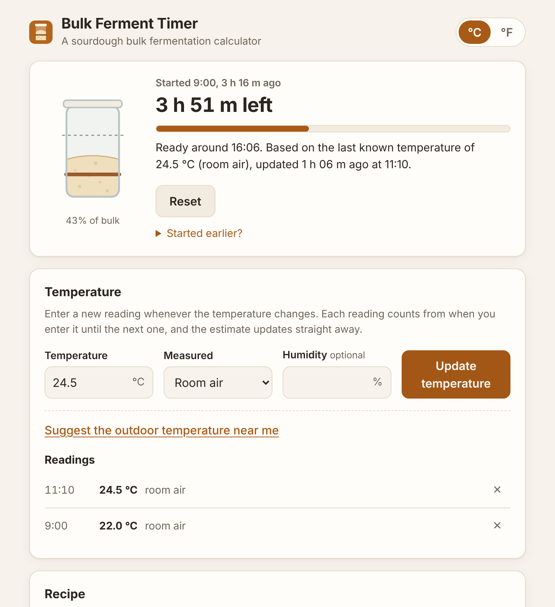

# Bulk Ferment Timer: web app

A self-hostable web calculator for sourdough bulk fermentation, built on the
same model as the Home Assistant integration in this repository, for people
who **don't** run Home Assistant. There are no sensors: the baker types in the
temperature, and the countdown updates as soon as they do.

<picture>
  <source media="(prefers-color-scheme: dark)" srcset="docs/screenshot-dark.png">
  
</picture>

## What it does

- **Estimate before you mix.** Enter the temperature and recipe to see how
  long bulk will take and when it would be ready if you started now.
- **Temperature-aware countdown.** Press *Start bulk*, then enter a new
  reading whenever the temperature changes. Each reading counts from when it
  was entered until the next one, so a warm afternoon followed by a cool
  evening is credited correctly. Time left is re-forecast from the latest
  reading.
- **A plain note on where the estimate comes from**, for example:
  > Ready around 4:50 PM. Based on the last known temperature of 23.5 °C
  > (room air), updated 1 h 12 m ago at 2:03 PM.

  If the last reading is more than 3 hours old, it suggests entering a new one.
- **Outdoor temperature suggestion (optional).** With the visitor's consent,
  the browser asks for their location and fetches the current outdoor
  temperature from [Open-Meteo](https://open-meteo.com/) as a suggestion
  they can choose to use. Outdoor temperature is usually not the same as the
  kitchen's, and the app says so.
- Room-air or dough-probe readings, optional humidity, °C/°F, recipe inputs
  (starter, flour, water, protein, starter hydration) and the model settings
  (Q10, reference temperature, base time).
- Optional browser notifications for "nearly done" and "done". These only
  arrive while the page is open in a tab, since there's no server to push
  from.
- Works on phones, follows the system light/dark theme, and can be added to
  the home screen.

## Privacy

Everything runs in the visitor's browser. Their bake, recipe and readings are
kept in that browser's local storage, and **nothing is sent to the server
hosting the app**: it only serves static files. There are no cookies,
analytics or third-party scripts.

On first visit a small notice explains this and asks whether to use location.
If the visitor allows it, their coordinates are rounded to about 1 km and sent
straight from their browser to Open-Meteo. They are never sent to your server
and never stored. *Privacy & location settings* at the bottom of the page
reopens the notice, which also has a *Forget my data* button.

Browsers only allow location on **HTTPS** (or `localhost`). Everything else
works over plain HTTP.

## Hosting

The app is just the files in [`public/`](public/). Pick whichever option suits
you.

### Option 1: GitHub Pages (free, HTTPS, nothing to run)

The workflow [`webapp-pages.yml`](../.github/workflows/webapp-pages.yml)
publishes `webapp/public` whenever it changes on `main`.

1. **Enable Actions** (forks only): open the repository's **Actions** tab and
   click *I understand my workflows, go ahead and enable them*.
2. **Turn on Pages:** **Settings → Pages → Build and deployment → Source:
   GitHub Actions**.
3. **Deploy:** merge to `main`, or run **Actions → Web app on GitHub Pages →
   Run workflow** on `main`. Pages only deploys from the default branch
   unless you change the `github-pages` environment's rules.
4. **Share the link:** `https://<owner>.github.io/<repository>/`, for example
   `https://rpimeekle.github.io/sourdough_bulk_fermenter/`. The address also
   appears in **Settings → Pages** and on the workflow run's summary.

Optional: add a custom domain under **Settings → Pages → Custom domain**
(GitHub provides the HTTPS certificate). Note that a GitHub Pages site is
public even if the repository is private (except on Enterprise plans).

### Option 2: Container image (TrueNAS, Docker, Unraid, a Raspberry Pi…)

The workflow [`webapp-image.yml`](../.github/workflows/webapp-image.yml)
builds a small, unprivileged nginx image for `amd64` and `arm64` and publishes
it as `ghcr.io/<owner>/sourdough-webapp`:

| Tag | When |
| --- | --- |
| `latest` | every change to `webapp/` on `main` |
| `1.2.3`, `1.2` | when you push a tag such as `v1.2.3` |
| `sha-abc1234` | every published build |

**First publish:** new packages on GitHub Container Registry are private. To
pull without logging in, open your profile → **Packages → sourdough-webapp →
Package settings → Change visibility → Public**.

The container listens on port **8080**, runs as a non-root user, works with a
read-only filesystem and needs no volumes. `/healthz` returns `ok` for health
checks.

#### TrueNAS SCALE (24.10 "Electric Eel" and later)

1. **Apps → Discover Apps → ⋮ → Install via YAML.**
2. Paste [`truenas-app.yaml`](truenas-app.yaml), replace `OWNER` with the
   GitHub account that publishes the image, and change the host port (`30080`)
   if it's taken.
3. Open `http://<truenas-ip>:30080`.
4. **To update:** in **Apps**, choose the app → **Pull Images** (or
   stop/start it) to fetch the new `latest`.

#### Docker Compose

```sh
cd webapp
# Edit docker-compose.yml: replace OWNER, or keep `build: .` to build locally.
docker compose up -d --build
```

#### Plain Docker

```sh
docker build -t sourdough-webapp webapp/
docker run -d --name sourdough-webapp -p 8080:8080 --read-only --tmpfs /tmp sourdough-webapp
```

#### Without a container

Serve `webapp/public/` from any web server or reverse proxy you already run
(Caddy, Nginx Proxy Manager, Traefik, Apache…). [`nginx.conf`](nginx.conf)
shows the recommended security headers.

### Letting other people reach a self-hosted copy

A container on your NAS is only reachable on your home network until you
expose it, and location needs HTTPS. Common choices:

- **Cloudflare Tunnel:** no ports opened on your router, free HTTPS. Run
  `cloudflared` (it's in the TrueNAS app catalogue) and point a public
  hostname at `http://<truenas-ip>:30080`.
- **Reverse proxy with Let's Encrypt** (for example Nginx Proxy Manager) plus
  port forwarding on your router. This works, but it exposes your NAS to the
  internet.
- **Tailscale:** private sharing with people you invite onto your tailnet.

If the goal is simply sharing the calculator publicly, GitHub Pages
(option 1) is the least effort and exposes nothing at home.

## Development

No build step and no dependencies: the app is plain HTML, CSS and JavaScript
modules.

```sh
# Run locally (modules need http://, not file://)
python3 -m http.server -d webapp/public 8000    # → http://localhost:8000

# Tests (Node 20+)
node --test webapp/tests/*.test.mjs
```

### Keeping the model in step with the integration

[`public/js/model.js`](public/js/model.js) is a port of
[`calc.py`](../custom_components/sourdough_ferment/calc.py). The parity test
compares the two across about 2,000 combinations of temperature, starter
ratio, humidity, hydration, protein and model settings. If you change either
model, regenerate the fixtures from the Python side and re-run the tests:

```sh
python3 webapp/tests/generate_fixtures.py
node --test webapp/tests/*.test.mjs
```

CI regenerates the fixtures and fails if they differ from the committed file.

### Layout

```
webapp/
├── public/              # everything that gets served
│   ├── index.html
│   ├── css/styles.css
│   ├── js/model.js      # fermentation maths (port of calc.py)
│   ├── js/bake.js       # countdown from logged readings
│   ├── js/app.js        # UI
│   ├── js/format.js, storage.js, weather.js
│   ├── sw.js            # minimal service worker (notifications; no caching)
│   └── manifest.webmanifest, icons/
├── tests/               # node:test suites + Python parity fixtures
├── Dockerfile, nginx.conf
├── docker-compose.yml
└── truenas-app.yaml
```
